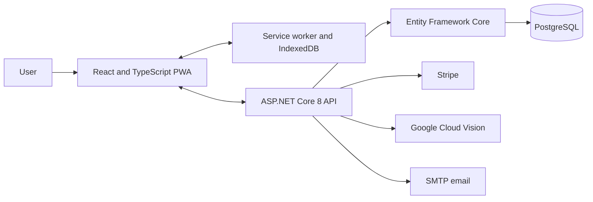

# Service Coeliaque

**A bilingual, installable progressive web app for organizing gluten-free living.** Service Coeliaque brings everyday planning tools into one place: recipes, grocery lists, purchase comparisons, receipt and invoice tracking, and yearly reports.

[View the source on GitHub](https://github.com/Bentheck/Projet_Coeliaque_PWA)

## Project overview

Service Coeliaque is a full-stack application built for French- and English-speaking users. It combines a responsive React client with an ASP.NET Core API and PostgreSQL database. The client is delivered as a Progressive Web App, with a service worker and an IndexedDB-backed offline data layer for supported workflows.

The project is designed to make recurring household tasks easier to manage while demonstrating production-oriented full-stack engineering: authentication, data persistence, offline behavior, third-party services, internationalization, and deployment tooling.

## Features

- **Recipes:** browse, create, edit, and share recipes.
- **Grocery planning:** create and manage shopping lists.
- **Product and purchase comparisons:** organize comparison entries and review them in reports.
- **Invoices and receipts:** record purchases, upload receipts, and use OCR-assisted receipt import for supported store formats.
- **Yearly reports:** review purchase and comparison data over time.
- **Community and help:** use the forum, FAQ, and contact features.
- **Accounts and memberships:** sign in, manage a profile, and access membership-gated modules.
- **French and English:** localized interface content and language-aware public pages.
- **Progressive Web App:** installable client with offline support for selected screens and data flows.
- **Demo experience:** the client includes `/demo` routes and seeded sample views for key planning modules.

## Engineering highlights

- **Offline-aware client:** service-worker caching, IndexedDB storage, synchronization helpers, and user-scoped cache cleanup.
- **Full-stack architecture:** React and TypeScript communicate with a REST API built on ASP.NET Core and Entity Framework Core.
- **Authentication and access control:** ASP.NET Core Identity is paired with client guards and server-side membership and feature checks.
- **External integrations:** Stripe supports membership payments, Google Cloud Vision powers receipt OCR, and SMTP handles application email.
- **Retailer-specific receipt parsing:** import mapping is organized by supported retailer to keep receipt handling extensible.
- **Internationalized routing and metadata:** public pages use locale-aware paths, SEO helpers, and a prerendering script.
- **Automated server tests:** xUnit tests cover areas such as membership access, receipt imports, and API controllers.

## Architecture



## Technology stack

| Area | Technologies |
| --- | --- |
| Frontend | React 19, TypeScript, Vite 7, React Router, React Bootstrap |
| Internationalization | i18next, react-i18next |
| Offline storage | Service Worker, IndexedDB, Dexie |
| Backend | C#, ASP.NET Core 8, ASP.NET Core Identity |
| Data | Entity Framework Core 8, PostgreSQL, Npgsql |
| Integrations | Stripe, Google Cloud Vision, MailKit / SMTP |
| Testing | xUnit, Microsoft.NET.Test.Sdk, EF Core InMemory |

## Repository layout

```text
.
├── Projet_Coeliaque_PWA.Server/       # ASP.NET Core API and backend services
├── Projet_Coeliaque_PWA.Server.Tests/  # xUnit backend tests
├── projet_coeliaque_pwa.client/       # React, TypeScript, and Vite PWA
├── scripts/                           # Production deployment helpers
└── Projet_Coeliaque_PWA.sln           # .NET solution
```

## Run locally

### Prerequisites

- .NET SDK 8
- Node.js and npm
- PostgreSQL
- HTTPS development certificates for the local client and API

### 1. Clone and install dependencies

```bash
git clone https://github.com/Bentheck/Projet_Coeliaque_PWA.git
cd Projet_Coeliaque_PWA
dotnet restore Projet_Coeliaque_PWA.sln
npm ci --prefix projet_coeliaque_pwa.client
```

### 2. Configure the database

Create a local PostgreSQL database, then store its connection string with .NET User Secrets:

```bash
dotnet user-secrets init --project Projet_Coeliaque_PWA.Server/Projet_Coeliaque_PWA.Server.csproj
dotnet user-secrets set "ConnectionStrings:DefaultConnection" "Host=localhost;Port=5432;Database=service_coeliaque;Username=postgres;Password=change-me" --project Projet_Coeliaque_PWA.Server/Projet_Coeliaque_PWA.Server.csproj
```

Replace the example database name and credentials with your local PostgreSQL settings. The backend uses Entity Framework Core migrations to initialize or update the schema when it starts.

### 3. Start the API and client

Trust the local .NET HTTPS certificate if you have not already:

```bash
dotnet dev-certs https --trust
```

Start the API in one terminal:

```bash
dotnet run --project Projet_Coeliaque_PWA.Server/Projet_Coeliaque_PWA.Server.csproj --launch-profile https
```

Start the Vite client in a second terminal:

```bash
npm --prefix projet_coeliaque_pwa.client run dev
```

The default HTTPS development URLs are `https://localhost:7244` for the API and `https://localhost:52960` for the client. Vite proxies `/api` and `/recipe-images` requests to the API.

## Configuration and integrations

Keep secrets in .NET User Secrets for local development and in your deployment platform's secret store in production. Do not commit credentials or private key files.

| Setting | Purpose |
| --- | --- |
| `ConnectionStrings:DefaultConnection` | PostgreSQL connection string; required to run the backend. |
| `Stripe:SecretKey` and `Stripe:PublishableKey` | Stripe test or live keys for membership checkout. |
| `Email` | SMTP settings used for application email. Development can use the built-in development email sender unless SMTP-in-development is enabled. |
| Google Cloud application credentials | Credentials for the receipt OCR integration. |

The repository includes example settings under `Projet_Coeliaque_PWA.Server/`. Use them as a reference for configuration shape, then provide your own values outside source control.

## Useful commands

Run these from the repository root unless noted otherwise:

| Command | Description |
| --- | --- |
| `dotnet restore Projet_Coeliaque_PWA.sln` | Restore .NET dependencies. |
| `dotnet test Projet_Coeliaque_PWA.Server.Tests/Projet_Coeliaque_PWA.Server.Tests.csproj` | Run backend tests. |
| `npm --prefix projet_coeliaque_pwa.client run lint` | Lint the frontend. |
| `npm --prefix projet_coeliaque_pwa.client run build` | Type-check and build the frontend. |
| `npm --prefix projet_coeliaque_pwa.client run build:prerender` | Build the frontend and prerender configured public pages. |

## Portfolio notes

This project demonstrates end-to-end feature development across a React PWA and a .NET API, including bilingual UX, offline data handling, database-backed workflows, payment and OCR integrations, and automated backend tests. The repository's `/demo` routes provide a starting point for exploring selected client-side flows with sample data.

The application includes informational content related to celiac disease; it is an organizational tool and is not a substitute for medical advice.
